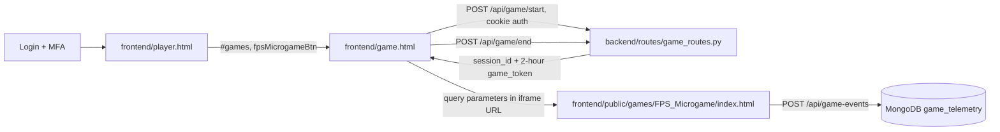

# GameHub and Unity Integration Audit

**Inspection date:** 2026-10-30  
**Scope:** Read-only inspection of the current GameHub, player/admin dashboards, Flask/MongoDB application, Unity projects, WebRTC code, and generated WebGL outputs.  
**Status:** Stage 1 inspection complete. No application, backend, or Unity source code was changed during this audit. The proposed implementation plan is pending approval.

## Executive findings

- The GameHub is **not a separate website or React application**. It is the `#games` view inside the existing player dashboard at `frontend/player.html`, reached from its “Game Hub” sidebar item.
- The existing game card is hard-coded in that page. Its `fpsMicrogameBtn` navigates to the existing `frontend/game.html` launch shell.
- That launch shell currently starts and embeds the **legacy `FPS_Microgame`** build at `frontend/public/games/FPS_Microgame/index.html`. This is a different project from the requested `unity-games/Multiplayer_FPS`.
- A generated WebGL output exists at `unity-games/Multiplayer_FPS/WebGL`, but Flask serves from `frontend/`. `frontend/public/games/Multiplayer_FPS/` is present only as a partial old `Build/` directory (four `WebBuild.*` files dated 2026-10-23); it has no `index.html`, `StreamingAssets/`, or `TemplateData/`, so it is not a complete hosted game.
- `unity-games/Multiplayer_FPS/Assets/Editor/GameHubWebGLBuild.cs` already defines a WebGL build targeting `frontend/public/games/Multiplayer_FPS/index.html`. A fresh successful build has not been verified. The current `.gitignore` does not allowlist this game's generated build directory.
- The canonical Flask app is `backend/app.py`; repository-root `app.py` is a compatibility launcher. MongoDB collections already exist for game sessions, raw telemetry, analysis events, and security events.
- The frontend is static HTML/CSS/JavaScript served by Flask or `http-server`; `frontend/package.json` has no React dependency or React build.
- Unity already has partial WebRTC signaling/UI code, but it does not currently start gameplay over the DataChannel. More importantly, the existing NetCode architecture explicitly makes WebGL client-only and rejects a WebGL server/host. The requested browser-hosted authoritative simulation is therefore a major gameplay-networking migration, not merely a GameHub card change.

## 1. Relevant workspace tree

```text
secure_fps_platform/
├── app.py                              # Root compatibility launcher
├── Documentation/
│   ├── GameHub_Unity_Integration_Audit.md
│   ├── GameHub_Unity_Integration_Plan.md
│   ├── GameHub_Unity_Integration_File_Change_Log.md
│   └── File_Change_Log.md              # Stage-by-stage change record requested
├── backend/
│   ├── app.py                          # Canonical Flask app and static-file server
│   ├── database/db.py                  # MongoClient and collection bindings
│   ├── models/ml_model.py              # Random Forest / Isolation Forest scoring
│   ├── routes/
│   │   ├── auth_routes.py
│   │   ├── game_routes.py              # Game launch, telemetry, analysis, admin monitoring
│   │   ├── player_routes.py
│   │   └── admin_routes.py             # Exists, but is not registered by backend/app.py
│   ├── services/auth.py
│   ├── tests/
│   └── webrtc_signaling.py             # Socket.IO handlers registered on canonical app
├── frontend/
│   ├── player.html                     # Player dashboard; contains the Game Hub view
│   ├── game.html                       # Existing authenticated launch shell and iframe
│   ├── admin.html                      # Admin dashboard; includes Game monitoring
│   ├── login.html, mfa.html, signup.html
│   ├── css/{styles,player,admin,ui-polish}.css
│   ├── js/{config,api,player,player-features,admin,login,mfa,...}.js
│   └── public/
│       ├── avatars/, backgrounds/
│       └── games/
│           ├── FPS_Microgame/          # Currently hosted legacy Unity WebGL artifact
│           └── Multiplayer_FPS/Build/  # Partial, stale WebGL files only; not launchable
└── unity-games/
    ├── FPS_Microgame/                  # Legacy game project associated with hosted artifact
    └── Multiplayer_FPS/                # Requested Unity project
        ├── Assets/
        │   ├── Editor/GameHubWebGLBuild.cs
        │   ├── Scenes/                 # MainMenu, GameScene, Persistents, subscenes
        │   ├── Prefabs/PlayerGhosts/   # Rifle and shotgun player prefabs
        │   ├── Plugins/WebGL/          # WebRTCBridge.jslib
        │   └── Scripts/                # Gameplay, NetCode/Ghost, WebRTC/UI code
        ├── Packages/manifest.json
        ├── ProjectSettings/
        └── WebGL/                      # Existing generated WebGL output; not app-hosted
```

Generated caches and local virtual environments are not part of the feature integration surface.

### Existing worktree state

The repository already had uncommitted work when this Stage 1 audit began: modified root `app.py`, `backend/app.py`, and `backend/requirements.txt`; new `backend/webrtc_signaling.py` and `backend/tests/test_webrtc_signaling.py`; and the untracked `unity-games/Multiplayer_FPS/` and `Documentation/` trees. These are pre-existing workspace changes, not changes made by this Stage 1 audit. They were inspected and must be preserved. In particular, Socket.IO is already wired into the current canonical Flask app; do not treat that work as a clean baseline or overwrite it.

## 2. Actual application, dashboard, and GameHub locations

| Concern | Actual location and evidence |
|---|---|
| Application entry point | `backend/app.py` constructs Flask, registers the auth/game/player blueprints, and serves files below `frontend/`. Root `app.py` loads and launches that application. |
| Login and MFA | `frontend/login.html`, `frontend/mfa.html`, `frontend/js/login.js`, `frontend/js/mfa.js`; API handlers are in `backend/routes/auth_routes.py` under `/api/auth`. |
| Player dashboard | `frontend/player.html`, with styling in `frontend/css/player.css` and behavior in `frontend/js/player.js` / `frontend/js/player-features.js`. |
| GameHub | The player dashboard's `<section id="games">`, selected by the `#games` sidebar link. It currently renders one static FPS Microgame card and its Play Game button. |
| Existing game cards | Static markup in `frontend/player.html`; no game catalog endpoint, CMS, or database-based registration flow was found. The card's `data-game` value is `fps-microgame`. |
| Existing Play Game action | `frontend/js/player.js` stores the prior match ID and navigates to `game.html`. |
| Existing launch page | `frontend/game.html`; on load it calls `POST /api/game/start`, then assigns an iframe to the legacy `FPS_Microgame` page. It provides a leave/finish confirmation and calls `/api/game/end`. |
| Admin dashboard | `frontend/admin.html`, `frontend/css/admin.css`, `frontend/js/admin.js`. Its “Game monitoring” section already displays gameplay alerts, analyzed sessions, and game history. |
| Actual active admin API | `backend/routes/game_routes.py` provides `/api/admin/overview` and gameplay-monitoring endpoints. `backend/app.py` does not register `backend/routes/admin_routes.py`; that file is not the active admin API surface. |
| Static asset hosting | `backend/app.py` sets `FRONTEND_DIR` to the repository's `frontend/` directory and serves `/<path:filename>` from there. Existing legacy game assets are below `frontend/public/games/FPS_Microgame/`. The Multiplayer_FPS folder contains only an old `Build/` subtree and is not launchable. |
| Frontend framework/tooling | Static HTML/CSS/JavaScript. `frontend/package.json` declares only `http-server`; no React runtime/build or JSX/TSX application was found. |
| Existing GameHub thumbnail | The FPS card uses the shared card design with CSS art/mascot, not a Unity build thumbnail or an image-backed game registry. |

### Observed existing launch flow



The current launch credential is placed in the iframe URL as `session_id` and `game_token`. That is existing behavior for the legacy game, not a recommended pattern for the new integration.

## 3. Authentication and player identity

- Password login is followed by MFA. After successful verification, `auth_routes.py` sets a Flask session cookie with `user_id` and `auth_session_record_id`.
- A server-side record in the MongoDB `sessions` collection and the user's `active_auth_session_id` enforce one active authenticated browser session. `/api/auth/me` supplies the logged-in user to the player dashboard.
- Because of the one-active-browser-session policy, the two-laptop match must use two different player accounts. Signing in to the same account on a second laptop can replace or invalidate the first browser session.
- The shared frontend `api.js` uses `credentials: "include"` for API requests. Player dashboard sections load profile, security, match, and leaderboard data using the authenticated cookie.
- `game_routes.py` uses the authenticated Flask session when creating and ending a game session. Telemetry ingestion resolves the player from the stored game-session record after checking the submitted session ID and game token.
- The existing start endpoint currently hard-codes the game as `FPS_Microgame`; the telemetry and admin UI also contain FPS Microgame defaults/labels.
- The current launch flow returns a two-hour token and appends it to the iframe URL. The new flow should not carry a reusable/long-lived credential in a URL. An authenticated launch request should create a game-bound, short-lived, single-use grant and deliver/redeem it outside query parameters.

## 4. Flask, MongoDB, existing games, and WebGL hosting

- MongoDB is configured in `backend/database/db.py` using `MONGO_URI` / `MONGO_DB` (with local development defaults). This is a collection-oriented MongoDB setup; no ORM schema layer for game rooms was found.
- Existing relevant collections are `users`, `sessions`, `game_sessions`, `game_telemetry`, `game_events`, `security_events`, `login_history`, and `reward_transactions`.
- `game_sessions` already stores the session ID, authenticated user, game label, token, active/completed/abandoned status, timestamps, and analysis-related fields.
- Current asset hosting follows `frontend/public/games/<game>/...`; `frontend/public/games/FPS_Microgame/` contains the legacy index, `Build/`, and `TemplateData/`. Unity's `Multiplayer_FPS/WebGL/` contains an `index.html`, `Build/`, `StreamingAssets/`, and `TemplateData/`, but is outside Flask's configured static root. The similarly named frontend destination contains only `Build/WebBuild.data`, `.framework.js`, `.loader.js`, and `.wasm` from 2026-10-23; the current Unity output uses `WebGL.*` names and is not present there.
- `GameHubWebGLBuild.Build()` builds all enabled scenes in `EditorBuildSettings.asset` to the frontend destination. This script exists already, but its output has not been rebuilt and served successfully in this audit.
- The generated Unity build has large `.data` and `.wasm` files (approximately 276 MB and 104 MB respectively at inspection). Its presence and timestamps do not prove it was built from the current source or tested in a browser.
- Unity's `ProjectSettings.asset` selects `APPLICATION:Default`; no project-owned `Assets/WebGLTemplates/FPSWebRTC` template was found. The current generated WebGL `index.html` loads Socket.IO from a CDN. Rebuilding with the default template can discard generated-file edits; provide a reproducible source template or another versioned client-loading mechanism rather than relying on edits to generated output.
- The project settings specify WebGL compression format `2` (Brotli) and disable decompression fallback, but the inspected generated artifacts use uncompressed filenames. Confirm the output of the next successful build. Flask already has `.br`/`.gz` negotiation, `Content-Encoding`, `Vary: Accept-Encoding`, and Unity MIME handling; a focused serving test exists but was not run during this audit. Recommended deployment: Brotli with Flask's existing correct header handling, after verifying the actual emitted filenames and browser response headers.
- `frontend/js/config.js` points at the current page's `/api` when served from port 5000 and otherwise targets port 5000 on the same host. The Unity bridge currently falls back to the iframe/page origin when its signaling URL is empty. If the frontend is served separately (for example via `http-server` on port 3000), that origin is not necessarily the Flask Socket.IO origin. Configure API and signaling origins consistently rather than assuming they match.
- Flask's network settings default to loopback (`127.0.0.1`). A second laptop cannot reach that default listener. A shared-host or deployed two-laptop demonstration needs an explicit reachable HTTPS/WSS deployment or reverse proxy, exact allowed origins, appropriate secure cookies, and STUN/TURN testing.
- The root `.gitignore` currently includes exceptions for the existing `FPS_Microgame` build assets. The planned `Multiplayer_FPS` WebGL deployment output needs an explicit build/deployment target and corresponding ignore/track policy; do not casually copy the project build into an arbitrary folder.

## 5. Existing telemetry, detection, and security reporting

- `POST /api/game-events` accepts a game token, session ID, event type, game label, and telemetry object. It checks token/session correspondence, active status, expiry, and account bans/suspensions, then stores raw events in `game_telemetry` with the session's database-resolved user ID.
- The current event ingestion path checks that `telemetry` is a dictionary, but this inspection did not find a strict event-type allowlist or per-event schema/sequence validation suitable for a new multiplayer protocol. A browser host must not be treated as a trusted verifier.
- The existing analyzer extracts session-level `accuracy`, `fire_rate`, `movement_speed`, `aim_smoothness`, and `kdr`, then invokes the Random Forest / Isolation Forest models in `backend/models/ml_model.py`. Results are stored in `game_events`; qualifying alerts are stored in `security_events`.
- Existing live/review surfaces already exist: admin overview/game monitoring in `frontend/admin.html` + `frontend/js/admin.js`; player-specific match/security data in `frontend/player.html` + `frontend/js/player.js` and `/api/player/matches` / `/api/player/security`.
- Login failures/successes are stored in `login_history`; account security events and player-visible admin review notes use existing security collections/routes.
- Existing ML output is a suspicious-session signal, not proof. The reviewed code does not establish server-verified multiplayer movement, damage, firing, ammo, or replay prevention for the requested Unity game.
- Existing signaling was integrated into the canonical Flask-SocketIO app in the preceding approved work. Its `backend/webrtc_signaling.py` currently keeps rooms/membership in process memory, caps a room at host plus one client, authenticates the Socket.IO connection using the active browser session, and relays bounded offer/answer/ICE messages. It does not persist room/session state in MongoDB or carry gameplay state through the backend.
- The existing signaling handlers do not bind room creation/joining to a `Multiplayer_FPS` game session or a launch grant; rooms have no database persistence or expiry. The browser bridge hard-codes Google's public STUN server, has no TURN entry or server-provided ICE configuration, and uses the page origin as signaling fallback when `signalingUrl` is empty.

## 6. Unity project inspection

### Scenes and assets

- Project: `unity-games/Multiplayer_FPS`; Unity Editor version `6000.3.26f1`.
- Enabled build scenes are `Assets/Scenes/MainMenu.unity`, `GameScene.unity`, `GameResourcesSubScene.unity`, `Persistents.unity`, and `SpawnPointsSubScene.unity`. `ServerScene.unity` exists but is not in the enabled build scene list.
- Player variants are `Assets/Prefabs/PlayerGhosts/ArmaturePlayer_Rifle.prefab` and `ArmaturePlayer_Shotgun.prefab`; each is a NetCode/Ghost-oriented prefab. `ClientPlayerInput.prefab`, `PlayerSpawner.prefab`, and `Assets/Prefabs/UI.prefab` are additional gameplay dependencies.
- `Assets/Scenes/Persistents.unity` contains `GhostBridgeManager` and `WeaponManager`, but no `WebRTCManager`.
- `Assets/Scripts/UI/Game/MainMenu.cs` already creates room/join-code controls and invokes `WebRTCManager`. It displays room and connection status, but the code does not start the match or spawn a second player on DataChannel open. `WebRTCRoomUI.cs` is an additional UI component, not evidence that the scene is wired.

### Gameplay and networking

- Unity packages include Entities, NetCode for Entities `1.14.3`, Unity Transport/Multiplayer Services dependencies, Character Controller, Input System, Addressables, and Unity Test Framework. Browser-native WebRTC uses the existing `.jslib` bridge rather than NetCode UDP.
- The manifest has no `com.unity.webrtc` dependency. The current bridge calls JavaScript `SendMessage` callbacks from `.jslib`; it does not implement gameplay replication or a per-session HMAC protocol.
- `GameManager.cs` creates a client-only world for WebGL and reports that WebGL must join a server-created session. `EntityDriverConstructor.cs` rejects WebGL host/server mode and direct UDP; Relay client mode is its supported NetCode WebGL path.
- Gameplay is coupled to NetCode client/server worlds and GhostBridge. `PlayerInput` / `ClientCommandInput` and `ClientInputSenderSystem` use `ICommandData` and `NetworkTick`; the server movement and join/spawn systems require NetCode state such as `NetworkTime`, `NetworkStreamDriver`, `NetworkId`, `GhostOwner`, and Ghost components.
- `ServerGameSystem.cs` currently handles NetCode join/disconnect, player prefab spawning, leaderboard membership, death, and respawn. `ServerPlayerMovementSystem.cs` processes command input and existing movement/shooting behavior in the server simulation. GhostBridge carries game-object and Ghost synchronization.
- Existing player-camera, animation, weapon, health, damage, shooting, HUD, death, respawn, and VFX functionality has references across these systems. It should be preserved and tested; changing transport alone will not make the ECS server simulation run as a WebRTC browser host.

### Existing WebRTC code

- `Assets/Plugins/WebGL/WebRTCBridge.jslib` creates a browser `RTCPeerConnection`, Socket.IO signaling client, and `game-data` DataChannel; it relays SDP/ICE and sends/receives string messages.
- `Assets/Scripts/Networking/WebRTCManager.cs` exposes room/status/message events and sends `HELLO_FROM_UNITY` when the DataChannel opens. There is no versioned gameplay protocol, player-state adapter, input validation path, or WebRTC-backed spawn/movement/combat replication.
- The bridge itself is browser JavaScript and conditionally compiled for WebGL, so it is the appropriate place for browser WebRTC. This does not make the game's existing Ghost networking compatible with the required WebRTC DataChannel architecture.
- The Socket.IO bridge uses the page origin by default after the prior phase, which only works when that origin actually serves the canonical Socket.IO backend; a separate frontend/API origin must be configured.
- The bridge and C# manager do not prove end-to-end browser connectivity. A real WebGL build, authenticated browser session, SDP/ICE exchange, open DataChannel, and send/receive test remain required.

## 7. Recommended integration location

1. **Add the game to the existing GameHub:** update the existing game card in `frontend/player.html` inside `#games`. Reuse `.player-game-grid` / `.game-card` styling in `frontend/css/player.css`; do not create a new dashboard, GameHub, library page, React app, or duplicate card view.
2. **Reuse the existing launch shell:** adapt `frontend/game.html` to launch `Multiplayer_FPS` rather than create another launch page. Keep its loading/error state, leave/return control, and integrate the safe launch grant before loading Unity.
3. **Serve the build using the observed convention:** configure a deterministic WebGL build/deployment output at `frontend/public/games/Multiplayer_FPS/`, matching the existing `frontend/public/games/FPS_Microgame/` path and `FRONTEND_DIR` static handler. Use an explicit build/deploy target; do not replace the legacy artifact or hand-copy unrelated generated files. The exact build automation and generated-asset tracking policy must be approved and tested.
4. **Use existing backend APIs and database collections:** extend the canonical `backend/routes/game_routes.py` launch/end/telemetry/reporting paths and `backend/webrtc_signaling.py`. Reuse `game_sessions`, `game_telemetry`, `game_events`, and `security_events` where their semantics fit. Add a dedicated persistent room/lobby collection only if the approved room lifecycle cannot be modeled safely in the existing game-session data; do not put multiplayer rooms into the authentication `sessions` collection.
5. **Extend existing dashboards in place:** use `frontend/admin.html` + `frontend/js/admin.js` and `frontend/player.html` + `frontend/js/player.js` / existing matches sections. Extend the active APIs in `game_routes.py` and `player_routes.py`; do not edit the currently unregistered `admin_routes.py` as though it were live.
6. **Keep the separate legacy project intact:** the current hosted `FPS_Microgame` artifact/project remains available until the new build and launch path pass end-to-end tests. Do not remove NetCode/Ghost files as part of this first integration.

## 8. Proposed file-level change scope

All actions below are **proposed and pending approval**.

| File/path | Proposed action | Why |
|---|---|---|
| `frontend/player.html` | Modify | Replace/update the one existing GameHub card and its Play Game target; preserve surrounding player dashboard and existing navigation. |
| `frontend/css/player.css` | Modify | Reuse the current card layout and add responsive presentation for a real FPS thumbnail/multiplayer label if needed. |
| `frontend/js/player.js` | Modify | Keep existing authenticated dashboard behavior; implement the single GameHub launch action and any return-to-match refresh behavior. |
| `frontend/game.html` | Modify | Reuse current launch shell and controls, request the authenticated game-specific launch, load the right Unity WebGL path, and avoid reusable token query parameters. |
| `frontend/public/games/Multiplayer_FPS/` | Replace/populate as generated build output | A partial stale `Build/` directory exists. Generate a complete fresh build at this path, including `index.html`, build files, `StreamingAssets/`, and template assets. Do not rely on the current stale `WebBuild.*` files. |
| `frontend/public/games/Multiplayer_FPS/thumbnail.*` (exact format TBD) | Create | Supply the game card image after an approved image source is selected/generated from the actual game. Existing cards use CSS art and no FPS image thumbnail exists. |
| `.gitignore` | Modify | Add narrow allowlist rules for the `Multiplayer_FPS` deployment output; the current broad Unity `Build/` ignore excludes it. |
| `backend/routes/game_routes.py` | Modify | Bind launch sessions to the actual game ID; add short-lived/single-use launch redemption as needed; validate and attribute bounded multiplayer telemetry; include session summaries in current admin/player APIs. |
| `backend/webrtc_signaling.py` | Modify | Bind signaling room creation/join to launch authorization and the durable match/session lifecycle; persist room state only if approved data model requires it; retain membership, size, and role checks. |
| `backend/database/db.py` | Conditional modify | Add a room collection binding only if a separate room record is needed after reviewing existing `game_sessions` semantics. |
| `backend/tests/` | Create/modify focused tests | Test authenticated launch, single-use/expiry behavior, room membership/capacity, telemetry validation/ownership, completion, and privacy boundaries. |
| `frontend/admin.html`, `frontend/js/admin.js`, `frontend/css/admin.css` | Modify in later phase | Extend the existing Game monitoring section for actual Multiplayer_FPS sessions/evidence; no separate admin page. |
| `frontend/player.html`, `frontend/js/player.js`, `frontend/css/player.css` | Modify in later phase | Add the user's own Multiplayer_FPS session summaries to the existing match/security views. |
| `unity-games/Multiplayer_FPS/Assets/WebGLTemplates/FPSWebRTC/` | Create after approval if selected | Provide a reproducible template that loads a pinned Socket.IO client and passes API/signaling configuration and the launch grant without query parameters. |
| `unity-games/Multiplayer_FPS/Assets/Plugins/WebGL/WebRTCBridge.jslib` | Modify in later phase | Configure same-origin or explicitly supplied backend URL; add safe launch handoff and robust connection lifecycle/message bounds. |
| `unity-games/Multiplayer_FPS/Assets/Scripts/Networking/WebRTCManager.cs` | Modify in later phase | Integrate the authenticated room/session lifecycle and clear status/error/leave events. |
| `unity-games/Multiplayer_FPS/Assets/Scripts/UI/Game/MainMenu.cs` | Modify in later phase | Reuse the current room/join UI and connect it to approved session creation, waiting, leave, and match-start states. |
| `unity-games/Multiplayer_FPS/Assets/Scripts/Networking/WebRTCMessageProtocol.cs` | Create in later phase | Define versioned, bounded, sequenced input/state/event envelopes. |
| `unity-games/Multiplayer_FPS/Assets/Scripts/Networking/WebRTCPlayerNetwork.cs` | Create in later phase | Connect DataChannel messages to an explicitly chosen host simulation and remote-player lifecycle. |
| `unity-games/Multiplayer_FPS/Assets/Scenes/Persistents.unity` (or equivalent controlled bootstrap) | Modify in later phase | Ensure one WebRTC manager exists before MainMenu subscriptions; currently it is absent. |
| `backend/config/multiplayer_fps_detection.json` | Create | Keep movement, teleport, fire-rate, mismatch, batch, and risk-scoring thresholds out of code. Calibrate against the host simulation before treating any anomaly as a confirmed violation. |
| `backend/tests/test_gamehub_unity_launch.py` and focused networking/telemetry tests | Create | Verify launch grants, ownership, replay, room membership, bounded telemetry, detection, and player/admin access. |
| `unity-games/Multiplayer_FPS/Assets/Scripts/Gameplay/...` and player prefabs | Modify only after feasibility spike | Adapt input, simulation, spawning, visual replication, shooting, health, damage, and respawn while preserving existing gameplay. Exact set is gated by the host-world spike. |
| `unity-games/Multiplayer_FPS/Assets/Editor/GameHubWebGLBuild.cs` | Keep for Stage 2; modify only if needed | Existing build entry point already targets the Flask static directory; verify it with a fresh build before changing it. |

## 9. Files to preserve

- Keep `frontend/player.html` as the existing dashboard and keep its existing non-game sections, cards, and navigation; change the current GameHub content in place.
- Keep `frontend/admin.html`, existing player/admin authentication and visual systems, `frontend/js/config.js`, and `frontend/js/api.js`; reuse their contracts unless tests demonstrate a necessary targeted change.
- Keep the legacy `frontend/public/games/FPS_Microgame/` artifact and `unity-games/FPS_Microgame/` project until replacement is verified.
- Keep `backend/app.py` as the canonical backend, existing auth/game/player blueprints, auth/session policy, and existing MongoDB collections. Do not create another Flask app, React app, or replacement dashboard.
- Keep `backend/routes/admin_routes.py` unchanged unless a future approved change explicitly registers it; active game monitoring is implemented elsewhere.
- Keep the Unity `MainMenu`, both player variants, gameplay assets, scenes, camera/control/animation/weapon/audio behavior, NetCode/Ghost source, and dedicated-server files until a specific tested migration requires a narrow change. Do not delete the original networking files.
- Do not add a Unity WebRTC package solely for browser-native WebRTC. Do not edit generated `WebGL/index.html` as the only solution because Unity uses the default template.

## 10. Risks, dependencies, and test status

| Risk/dependency | Evidence / consequence |
|---|---|
| Browser-host authority is not trusted | Laptop 1 controls its own browser and can modify the simulation or lie about reports. Backend checks can validate submitted evidence but cannot independently attest that a browser host simulated honestly. Do not claim dedicated-server security. |
| Existing WebGL game cannot host NetCode server | `GameManager` and `EntityDriverConstructor` explicitly make WebGL client-only. Existing Ghost replication does not automatically run over WebRTC. This is the primary gameplay blocker. |
| Current WebRTC is connection proof code only | Existing UI and HELLO message do not spawn players or synchronize input, transforms, weapons, health, or respawn. |
| Build/static hosting mismatch | Unity output is under `unity-games/Multiplayer_FPS/WebGL`; Flask serves `frontend/`. No configured current build/deploy step connects them. |
| Token exposure | Existing `game.html` places the two-hour game token in a URL. A new game should use short-lived, single-use authorization delivered outside URL parameters. |
| Session/auth origin | API URL can be on port 5000 while the front-end may run on port 3000. The current WebRTC empty-URL fallback uses the page origin. Cookies, CORS, Socket.IO URL, HTTPS, and iframe origin must be aligned. |
| Room persistence and multi-worker behavior | WebRTC room membership is currently in process memory. Restarting the process loses rooms; multiple backend workers do not share membership. Persistent room/session ownership is not yet implemented. |
| WebGL output size and hosting headers | Existing `.data`/`.wasm` files are large. Deployment must verify compression, WASM MIME type, cache policy, HTTPS/WSS, and loading/error behavior. |
| Telemetry trust and protocol | Existing event ingestion is not a host-authoritative protocol validator. New telemetry must be bounded, schema-checked, rate-limited, sequenced where applicable, and attributed to the authenticated session on the backend. |
| Detection scope | Existing ML signals use aggregate session features; movement/teleport/fire-rate rule violations for this Unity multiplayer protocol are not yet independently verified. Anomaly scores must remain review signals, not automatic proof. |
| External services | A reachable deployment URL, TURN configuration/credentials, HTTPS/WSS, and two-laptop test network are not established by this inspection. |
| Shared HMAC key | Both browsers must be able to sign messages, so a client-held per-session HMAC key can be extracted and used to forge messages. HMAC plus sequence checks can reject unauthenticated, altered, or replayed traffic, but does not make either browser trustworthy. Use TLS, short-lived session keys, server-side membership checks, both-player reports, physical plausibility checks, and independent cross-checks; do not present HMAC as anti-cheat proof. |
| Existing gameplay thresholds | Player prefab movement values include 4.7 m/s walk/sprint and 1.2 m jump height, but the serialized landing speed multiplier is 10 while the authoring default is 0.6. `CooldownInMs` is used directly as a float timer and the current weapon assets set 0.1 and 1.0. Validate these semantics in the host simulation before choosing production thresholds. |

### Threat model: host-authoritative browser limitation

The host browser will decide movement acceptance, hits, damage, death, and match outcomes, but the host controls that browser and can alter the Unity runtime, JavaScript bridge, DataChannel payloads, and local signing key. The backend can independently validate message shape, sequence, HMAC, session membership, rate limits, physical movement/fire constraints, and contradictions between host and client reports; it cannot prove the host actually ran the intended simulation. A client signature is evidence of who possessed a session key, not evidence that the reported gameplay is truthful. Keep uncertain anomalies as suspicious/review items, distinguish deterministic protocol/validation failures, and never auto-ban from one uncertain signal. A trusted dedicated authoritative server would be required to remove this limitation.

**Test status at audit:** Location and flow findings are **PASSED (code inspection only)**. This audit did not execute application/unit tests or a browser, and did not run Unity. The existing signaling/serving test files are present but are **NOT TESTED in this audit**. GameHub-to-legacy-game browser play, Multiplayer_FPS fresh build/serving, launch grant, SDP/ICE/DataChannel, two-laptop play, gameplay replication, telemetry, MongoDB session reporting, dashboard reporting, and different-network/TURN behavior are **NOT TESTED**. The project contains a prior recorded Unity build failure due to Windows paging-file pressure; that result was not reproduced here and the current player compilation remains **NOT TESTED**. WebGL NetCode server/host is **BLOCKED by explicit source guards**, not by a test result.

## Approval gate

Recommended target: the existing `frontend/player.html#games` GameHub card, reusing `frontend/game.html` as the launch shell and the existing Flask/MongoDB/dashboard surfaces. This plan is pending the user's approval. The first implementation milestone after approval should be a safe GameHub launch of a fresh Unity build; actual multiplayer gameplay remains gated on the WebRTC proof and browser-host simulation feasibility proof.
