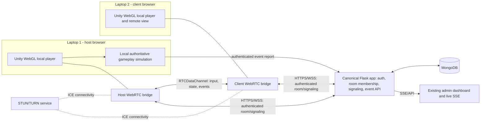

# WebRTC Migration Audit

**Project:** Secure Online Gaming Platform - Multiplayer FPS  
**Inspection date:** 2026-10-30  
**Status:** Phase 1 audit complete and migration approved. Phase 3 backend signaling is implemented and its focused tests pass; the browser WebRTC/DataChannel proof is unverified, so work is paused before Phase 4/gameplay migration.

## 1. Scope and repository state

The Unity project at `unity-games\Multiplayer_FPS` was inventoried, including its 123 C# files under `Assets\Scripts`, scenes, prefabs, package manifest, ProjectSettings, WebGL plugin/output, and server build profiles. Networking, input, gameplay, spawning, health, UI, and their references were inspected in detail. The other 2 C# files under `Assets` are TutorialInfo files.

At the start of the audit, `backend\webrtc_signaling.py` and the Unity project directory were untracked. The signaling module was modified only after the migration plan was approved; the Unity project remains untracked. The `Documentation` directory did not exist before this report.

## 2. Existing architecture

- Unity Editor version: `6000.3.26f1`.
- Unity packages include Entities, NetCode for Entities `1.14.3`, Unity Transport (transitive through networking packages), Character Controller, Input System, Addressables, Multiplayer Services, Cinemachine, URP, and the Unity Test Framework.
- Gameplay uses separate NetCode client and server ECS worlds. `GhostBridgeBootstrap`, `GhostGameObject`, `GhostMonoBehaviour`, and GhostBridge systems connect ECS ghost entities to GameObjects and replicate ghost state/RPCs.
- `GameManager` and `GameConnection` currently start Unity Multiplayer Services/Relay or direct transport sessions. `EntityDriverConstructor` rejects WebGL server/direct UDP use and registers a WebSocket Relay client driver for WebGL. `GameManager` explicitly creates only a client world for a WebGL Relay session.
- Dedicated-server scripts and Linux/Windows server build profiles exist. They are not required for the proposed two-browser demo and should remain intact as legacy/non-WebGL paths.
- `EditorBuildSettings.asset` includes MainMenu, GameScene, GameResourcesSubScene, Persistents, and SpawnPointsSubScene. `ServerScene` is present in Assets but is not in this scene list.
- `ProjectSettings.asset` selects Unity's default WebGL template. A `WebGL` build/output directory exists, and a Linux server build exists under `Builds`; their presence does not establish that the current source has been rebuilt or tested.

### Current architecture diagram

```mermaid
flowchart LR
    C[Unity client browser or desktop] -->|NetCode command input / Unity Transport| H[NetCode server world]
    H -->|Ghost fields and RPCs / Unity Transport| C
    H --> M[GhostBridge GameObject and ECS systems]
    G[GameManager and GameConnection] -->|Unity Multiplayer Services / Relay or direct transport| H
    A[Flask API] --> D[(MongoDB)]
    F[Static HTML and JavaScript dashboard] -->|HTTP API and SSE| A
    S[backend/webrtc_signaling.py] -. separate Socket.IO Flask app .-> C
```

The final line represents partial WebRTC work, not an integrated or verified production path.

## 3. Existing networking flow

1. `GameManager` creates a client world and, for host sessions outside WebGL, a server world. `GhostBridgeBootstrap` manages those worlds and their GameObject hierarchies.
2. `GameConnection` chooses Unity Relay/Multiplayer Services or direct endpoints. `EntityDriverConstructor` configures Unity Transport drivers; the regular game connection lifecycle is managed by `GameManager`.
3. `ClientGameSystem` sends a `ClientJoinRequestRpc`. `ServerGameSystem` accepts a request from a connected NetCode connection, creates the player's ECS entities, and assigns the connection's command target.
4. `ClientInputSenderSystem` places tick-indexed `ClientCommandInput` values into a NetCode command buffer. Server systems consume command data and GhostBridge replication distributes snapshots and RPCs.
5. Client connection and network status systems observe `NetworkStreamConnection`, `NetworkStreamDriver`, and NetCode snapshot state.

The WebGL code already avoids a WebGL server world and direct UDP; this does not create the requested browser-hosted authority. Neither NetCode Ghost replication nor Unity Transport is a WebRTC transport in this project.

## 4. Player input

`PlayerInput` contains `MoveInput`, accumulated `LookYawPitchDegrees`, and jump/shoot/reload flags. `ClientInputReaderSystem` reads the generated Input System actions, accumulates/clamps look angles, and writes `ClientInput` and `ClientMovementInput`. `ClientInputSenderSystem` collects values by `NetworkTime.ServerTick` into `ClientCommandInput : ICommandData`, including interpolation tick information and input for prediction.

For WebRTC, the logical input may be reused, but the NetCode command buffer and tick ownership cannot be presumed to cross the DataChannel. A protocol envelope, sequence validation, and an explicit adapter between the channel and host simulation are required.

## 5. Spawning, movement, and respawning

- `ServerGameSystem` processes join RPCs, maps NetCode network IDs to entities, instantiates the input and selected rifle/shotgun player prefabs, assigns `GhostOwner`, and initializes health/ammo. Spawn points are selected from the baked spawn-point entities.
- The server deletes disconnected players and their input entity. It tracks death with `PendingRespawn` and respawns the selected character after five seconds.
- `ServerPlayerMovementSystem` consumes command-buffer inputs, advances cooldown/reload state, invokes `FirstPersonController` movement, applies the resulting transform, handles hitscan, and spawns server projectiles/VFX. `FirstPersonController` contains the shared movement, camera-facing rotation, gravity, jump, animation, and audio behavior.
- `PlayerPredictionSystem` performs local predicted movement/shooting and `ClientInterpolatedPlayerMovementSystem` applies remote interpolated state. `PlayerMovementHistory` is for prediction comparison; it is not cheat detection.

The server movement path currently trusts the numeric movement/look input values it receives. There are no explicit speed, teleport, map-bound, or per-input sequence/replay checks.

## 6. Shooting, damage, health, and ammo

- `ServerPlayerMovementSystem` reads shoot/reload flags, increments weapon cooldown, checks available ammo and reload state, decrements ammo, and processes hitscan damage on the server. Projectile weapons are spawned as server ghosts.
- `Projectile.UpdateServer` performs server collision and applies weapon-configured damage; it updates target health/hit fields and leaderboard kills. Client prediction exists separately for responsive local feedback/projectile reconciliation.
- `CurrentHealth`, `MaxHealth`, weapon ID, cooldown, ammo, last-damage/shot/jump/land/reload ticks, and reload timer live on `PredictedPlayerGhost`; many are `[GhostField]` values replicated by NetCode. `InGameHUD`, animation handlers, and damage visuals read that state.
- `WeaponData.CooldownInMs` is incremented/compared against a delta-time value in seconds; current asset values appear to be second-scale values despite the field name. Confirm the unit/serialized data before defining fire-rate validation.

The current NetCode server path already makes health/damage and ammo decisions server-side. Those semantics must move to the browser host's local authoritative simulation, not to client-supplied state messages.

## 7. Existing WebRTC work and gaps

Already present:

- `Assets\Plugins\WebGL\WebRTCBridge.jslib` creates a browser `RTCPeerConnection`, offers/answers, exchanges ICE candidates over Socket.IO, creates a `game-data` DataChannel, and forwards status/messages to Unity `SendMessage`.
- `Assets\Scripts\Networking\WebRTCManager.cs` wraps the JavaScript imports and callbacks; on connection it sends only `HELLO_FROM_UNITY`.
- `Assets\Scripts\Networking\WebRTCRoomUI.cs` and `Assets\Scripts\UI\Game\MainMenu.cs` expose room create/join/status controls.
- `WebGL\index.html` currently includes a Socket.IO CDN script before the Unity loader.
- `backend\webrtc_signaling.py` has in-memory, two-peer room creation/joining and signal relay handlers.

Not implemented or not wired:

- No `WebRTCMessageProtocol.cs` or `WebRTCPlayerNetwork.cs` exists. The DataChannel carries no gameplay input/state protocol.
- `WebRTCManager` has a placeholder signaling URL, no authentication/game-session validation, no structured protocol, and no teardown/room lifecycle API. It is WebGL-only and has no Editor test transport.
- The WebRTC manager is not referenced by the serialized scenes/prefabs. `Persistents.unity` currently contains `GhostBridgeManager` and `WeaponManager`; the menu code reports a missing manager if no GameObject is installed.
- Both player prefabs are NetCode Ghost prefabs with `GhostGameObject`, `GhostAuthoringComponent`, `PredictedPlayerGhostAuthoring`, and `FirstPersonController`; their camera/visual/controller references must be preserved while the transport boundary changes.
- The current menu reports room status but does not start a local host simulation, spawn/join a gameplay player, or connect messages to gameplay.
- The JS bridge currently uses a public STUN server only; there is no TURN configuration or credential provisioning. It does not impose a protocol message size/field limit and has no explicit full peer/channel/socket cleanup.
- The existing Unity WebGL build output is not a custom template. Its CDN script is outside the HTML doctype and may be lost on the next build. `Assets\WebGLTemplates` is absent, so a reusable template is needed for reliable rebuilds.
- `WebRTCBridge.jslib` compilation and browser runtime behavior have not been verified.

## 8. Flask, MongoDB, and dashboard integration

- The canonical Flask application is `backend\app.py`; root `app.py` is a compatibility launcher. `backend\app.py` registers existing auth/game/player blueprints and serves the static frontend. It currently runs Flask directly and does not create/register a Socket.IO instance.
- `backend\routes\admin_routes.py` exists but is not registered by the canonical app. The active admin dashboard routes are served through the registered game routes; avoid adding dashboard features to an unregistered blueprint without explicitly wiring it.
- `backend\webrtc_signaling.py` creates a second Flask app with a hard-coded development secret, wildcard Socket.IO CORS, in-memory rooms, no authentication, and no MongoDB. It is untracked and imports Flask-SocketIO, which is not listed in `backend\requirements.txt`. It should be integrated into the canonical app rather than launched as a second backend.
- MongoDB already has collections for users, browser auth sessions, login history, game sessions, raw telemetry, analysis events, and security events. There is no room/player-presence collection.
- Auth includes password hashing, MFA, server-side session records/revocation, login success/failure history, and account status checks. `/api/game/start` creates an expiring game token; `/api/game-events` validates that token and stores event telemetry. Unity Multiplayer_FPS does not currently call these endpoints.
- Existing backend event APIs and the security dashboard are built around account events and telemetry/ML analysis. They can be extended for WebRTC room and host-reported security events, but the browser host's reports are not independent proof of cheating.
- `frontend` is static HTML/CSS/vanilla JavaScript, not a React application. It has an admin dashboard with player/security/gameplay analysis, login history, and an SSE live-update path. It does not show active WebRTC rooms, live connected-player count, or movement/fire-rate events from this Unity game.
- `frontend\game.html` embeds the existing `frontend\public\games\FPS_Microgame` build. The root README also refers to `unity-games\FPS_Microgame`; the actual project is `unity-games\Multiplayer_FPS`.

## 9. Target architecture proposal



The browser host remains the sole authority for the demo's gameplay state. Flask authenticates/signals peers and stores security telemetry; it does not simulate the match. A malicious host can alter its own browser and falsify its authoritative results. This architecture is suitable for a capstone demonstration, not a trusted competitive production server.

Proposed messages are explicit versioned envelopes with a bounded byte size, authenticated peer/player ID, monotonic sequence, message type, and validated payload. Client input messages contain only movement/look/action intent. Host state messages contain host-produced positions, rotations, health, ammo, weapon/cooldown and gameplay events. Clients never send authoritative health, damage, or position updates.

## 10. Proposed file changes

Each entry is a migration candidate, not an approved change. See `WebRTC_File_Change_Log.md` for the pending action list.

| File | Proposed action and reason |
|---|---|
| `Assets\Plugins\WebGL\WebRTCBridge.jslib` | Modify existing bridge for configurable ICE, robust offer/answer/candidate ordering, bounded sends, reconnect/close cleanup, and stable Unity callbacks. It already exists; do not replace it wholesale. |
| `Assets\Scripts\Networking\WebRTCManager.cs` | Modify to obtain a short-lived authenticated game/session credential, manage signaling/room/peer lifecycle, expose typed events, and surface errors. |
| `Assets\Scripts\Networking\WebRTCRoomUI.cs` | Modify or keep as a reusable UI component after checking scene wiring and null-safe retry/status behavior. |
| `Assets\Scripts\UI\Game\MainMenu.cs` | Modify the existing room controls to call the approved lifecycle and enter gameplay only after the host/client role is established. |
| `Assets\Scenes\Persistents.unity` | Modify to install exactly one persistent WebRTC manager and configure safe public service URLs; no secrets belong here. |
| `Assets\Scripts\Networking\WebRTCMessageProtocol.cs` | Create typed, versioned message envelopes, DTOs, serialization/deserialization, size and field validation, sequence handling, and player IDs. |
| `Assets\Scripts\Networking\WebRTCPlayerNetwork.cs` | Create a transport adapter/player registry for local input, remote input reception, host snapshots, remote visuals, disconnects, and respawn notifications. |
| `Assets\Scripts\Gameplay\GameManager\GameManager.cs` | Modify WebGL flow so room creation/join starts the required local host/client gameplay lifecycle without invoking the old WebGL client-only Relay path. Preserve non-WebGL behavior. |
| `Assets\Scripts\GhostBridge\GhostBridgeBootstrap.cs`, `GhostBridgeManager.cs` | Adapt only after a WebGL host-world spike proves the required local ECS/GameObject runtime. Current world startup and server-driver assumptions are NetCode-specific. |
| `Assets\Scripts\Networking\Client\ClientConnectionSystem.cs`, `ClientGameSystem.cs` | Adapt WebGL connection/join handling; current systems depend on `NetworkStreamConnection` and a join RPC. Keep legacy non-WebGL flows. |
| `Assets\Scripts\Gameplay\Input\ClientInputReaderSystem.cs`, `ClientInputSenderSystem.cs`, `PlayerCommandInput.cs` | Integrate the existing input model with WebRTC while preserving camera, look, movement, jump, shoot, and reload. The NetCode tick command buffer must not be presented as the WebRTC protocol. |
| `Assets\Scripts\Networking\Server\ServerGameSystem.cs` | Adapt host-side join, identity, spawn, disconnect cleanup, and respawn state to WebRTC player membership. |
| `Assets\Scripts\Networking\Server\ServerGameData.cs` | Adapt or isolate `ClientsMap`, `JoinedClient`, and NetworkId-keyed server state when WebRTC player IDs replace NetCode connection IDs. |
| `Assets\Scripts\Gameplay\Player\Movement\ServerPlayerMovementSystem.cs`, `GhostBridge\Player\PlayerPredictionSystem.cs`, `ClientInterpolatedPlayerMovementSystem.cs`, `GhostBridge\Player\PredictionComponents.cs` | Adapt the authoritative movement/state boundary and local prediction/interpolation. These systems currently rely on NetCode ticks, command buffers, GhostFields, and client/server world filters; do not assume snapshots replicate over DataChannel. |
| `Assets\Scripts\Gameplay\Player\PlayerGhost\PlayerGhost.cs`, `PlayerGhostManager.cs`, `Gameplay\UI\InGameHUD.cs`, `Gameplay\UI\RespawnScreen.cs`, `UI\SessionInfo\NetworkStatusSystem.cs` | Preserve player camera/visual/UI behavior while replacing role, health/ammo, respawn, and network-status reads that currently depend on Ghost/ECS/NetworkStream state. |
| `Assets\Scripts\Gameplay\Player\Projectile\Projectile.cs`, `ProjectileReconciliationSystem.cs`, `Gameplay\VisualEffects\VisualEffectManager.cs`, `Gameplay\VisualEffects\GhostVisualEffect.cs`, `Gameplay\Leaderboard\GameLeaderboard.cs`, `GhostBridge\Spawning\GhostSpawner.cs`, `ManagerGhostsSpawner.cs` | Adapt server-authoritative firing/damage and events, or keep those features temporarily behind the old simulation. These use Ghost spawning, Ghost RPCs, or role lookups. |
| `Assets\Prefabs\PlayerGhosts\ArmaturePlayer_Rifle.prefab`, `ArmaturePlayer_Shotgun.prefab` | Preserve both prefab variants and their camera/animation/controller wiring; update transport-specific authoring only if the WebGL host-world spike requires it. |
| `ProjectSettings\ProjectSettings.asset` | Set a project-owned WebGL template after one is created; preserve current build options unless testing shows a required change. |
| `Assets\WebGLTemplates\FPSWebRTC\` | Create by copying the current Unity default template, then load the pinned/self-hosted Socket.IO client before Unity initialization and expose documented build configuration. Do not use a minimal replacement page. |
| `backend\requirements.txt` | Add the Socket.IO server dependency only after integrating the existing signaling handlers into the canonical app. |
| `backend\app.py`, `backend\webrtc_signaling.py` | Modify the canonical app to own Socket.IO and refactor the existing signaling module into registered handlers. Remove the duplicate Flask app, hard-coded secret, wildcard production CORS, and in-memory-only membership. |
| repository-root `app.py` | Modify the compatibility launcher to export and run the canonical Socket.IO server rather than starting Flask without Socket.IO support. |
| `backend\database\db.py`, `backend\routes\game_routes.py` (or a small registered route module if needed) | Store room/player membership and authenticated WebRTC security events in existing MongoDB conventions; reuse/extend the game-token/event path instead of creating duplicate auth. |
| `backend\tests\test_webrtc_signaling.py` | Create focused tests for authenticated room create/join, membership, offer/answer/ICE relay, disconnect, malformed/oversize messages, and event storage. |
| `frontend\admin.html`, `frontend\js\admin.js`, `frontend\css\admin.css`, `frontend\js\config.js` | Extend the existing dashboard with rooms, connected player state, host-reported alerts, and history using current API/SSE patterns. The current app is vanilla JS, not React. |
| `frontend\game.html` and current game-serving/configuration path | Point the authenticated game launch to a build of `Multiplayer_FPS`, not the unrelated/legacy `FPS_Microgame` artifact, and preserve the existing sign-in flow. |
| `README.md`, `Documentation\Complete_Demo_Guide.md` | Correct project paths and, after implementation/testing, document setup, two-laptop demo, tests, security demo, and troubleshooting. The complete guide is deferred until implementation is approved and tested. |

## 11. Files/assets expected to remain unchanged

Initially preserve all environment art, map geometry, spawn-point data, character meshes/rigs/animations, audio clips/SoundDefs, weapon ScriptableObjects, Addressables content, generated Input System actions, and the existing UI Toolkit styling. Keep unrelated audio, utility, and gameplay scripts unchanged unless a concrete dependency is found during implementation.

Keep the original Linux/Windows dedicated-server build profiles, `ServerBootstrap.cs`, `UGS_ServerBootstrap.cs`, direct/Relay desktop code, and existing NetCode/Ghost implementation as legacy paths during staged migration. Do not delete these files. Avoid editing generated `WebGL`/`Builds` output as a substitute for source templates or source changes. The main gameplay scenes and spawn subscene should remain intact; `Persistents.unity` is the identified wiring candidate.

`Packages\manifest.json` does not need a Unity WebRTC dependency for browser-native WebRTC. Do not add a package unless the approved implementation demonstrates a concrete need.

The following transport-specific files can remain unchanged during the first WebRTC stages because the browser path should bypass them while desktop/server behavior is preserved: `Networking\GameConnection\GameConnection.cs`, `EntityNetworkHandler.cs`, `EntityDriverConstructor.cs`, `Networking\Client\ConnectionSettings.cs`, `Networking\Client\ClientInputInitSystem.cs`, `Networking\Shared\Rpcs.cs`, `Gameplay\Player\Movement\PlayerMovementHistory.cs`, and the current `DedicatedServer` scripts. `GhostBridge\Ghosts\GhostGameObject\*` and `GhostBridge\Systems\*` can also remain as the legacy Ghost path; whether their local entity/GameObject lifecycle can be reused by the browser host is a Phase 6 feasibility question, not an assumption. Keep `Assets\Prefabs\UI.prefab`, `ClientPlayerInput.prefab`, and the existing gameplay/map/spawn scenes unless a tested implementation requires a targeted serialized reference change.

## 12. Dependencies and compatibility issues

1. Browser-native WebRTC APIs are available only in the browser runtime. The current C# P/Invoke bridge has no Editor implementation; the Unity Editor cannot validate a full room flow without a test adapter or WebGL/browser run.
2. The current Socket.IO script is loaded from a CDN only in generated `WebGL\index.html`. The default template selection means rebuilding may remove that edit. Production should use HTTPS/WSS and a pinned/self-hosted client asset.
3. Phase 3 declared Flask-SocketIO and registered signaling handlers on the canonical app. Room records remain in process memory; MongoDB persistence and deployment configuration are deferred to Phase 9.
4. Flask's current default bind is loopback, and its CORS/session cookie settings are configured for the current browser app. A two-laptop deployment needs explicit reachable bind, exact allowed origins, secure cookies, WSS, and compatible credential handling.
5. STUN-only ICE is insufficient for some NAT/firewall pairs. A TURN service and short-lived credentials may be needed; no TURN endpoint/credentials are configured.
6. NetCode Ghost fields, `NetworkTick`, command buffers, RPCs, `NetworkTime`, `NetworkStreamDriver`, server/client system filters, and GhostBridge lifecycle are coupled across dozens of scripts. A transport replacement alone will not make these systems run as a WebRTC host.
7. The existing frontend is not React, and the current in-page game build is not the inspected Multiplayer_FPS project. The migration should either extend the current dashboard or explicitly approve a React rewrite.
8. MongoDB database/room/session deployment configuration and a reachable public HTTPS/WSS/TURN setup were not supplied or tested.

## 13. Risks and security boundaries

- **Host trust:** browser-hosted authority is controlled by Laptop 1's owner. It can be modified and can lie about input validation, health, results, and security events. This limitation must appear in the demo and final documentation.
- A two-peer DataChannel is peer-to-peer. Flask signaling authenticates/authorizes connection setup; it cannot inspect or enforce gameplay after connection unless the game data is routed through it (which is not this architecture).
- Never accept client-provided player position, health, damage, ammo, weapon cooldown, or kill count as authoritative. Server/host must derive these from validated input and authoritative world collision.
- Validate room membership and authenticated identity on every signaling operation; enforce bounded signaling/message sizes; sequence/replay-check gameplay input; rate-limit room/auth attempts; clean up membership on disconnect.
- A compromised host can bypass these checks. Backend ML/security alerts are evidence for review, not proof of cheating.
- Preserve existing camera, animation, jump, shot SFX/VFX, reload, HUD, leaderboard, death, and respawn behavior while swapping transport. The number of interdependent GhostBridge systems makes a one-shot rewrite unsafe.

## 14. Phased migration plan and test checklist

The migration must proceed in the requested order and stop at the first phase failure. Phase 3 has started but is incomplete; later phases have not started.

| Phase | Work | Audit status |
|---|---|---|
| 1. Full inspection and audit | Inventory Unity/backend/frontend, dependencies, references, and current security/data flows. | Complete; this report only. |
| 2. WebRTC design and migration plan | Approve explicit host-authority/DataChannel architecture, security boundary, UI approach, and file plan. | Approved; extend the existing vanilla JavaScript dashboard. |
| 3. Minimal signaling/DataChannel test | Integrate signaling with canonical Flask app; demonstrate create/join, offer/answer, ICE, open channel, and bounded test message. | Backend create/join, auth, offer/answer/ICE relay, malformed/oversize rejection, and disconnect tests pass. Browser ICE negotiation and RTCDataChannel message exchange are unverified; stop here. |
| 4. Unity WebGL JavaScript bridge | Stabilize bridge callbacks, message bounds, ICE/TURN configuration, lifecycle, and persistent WebGL template. | Not started; only same-origin authenticated Socket.IO configuration was adjusted as a Phase 3 prerequisite. |
| 5. Player input transmission | Send authenticated, sequenced input intent only; validate it on host. | Not implemented/tested. |
| 6. Host movement and player synchronization | Boot browser-local authority; validate movement; spawn and interpolate remote players. | Not implemented/tested; NetCode host-world compatibility is a critical spike. |
| 7. Shooting, health, ammo, respawn | Host owns weapon/cooldown/ammo/collision/damage/health and respawn; clients display snapshots/events. | Existing server gameplay is prior art; WebRTC path not implemented/tested. |
| 8. Security validation/detection | Add speed/teleport/bounds/fire-rate/ammo/weapon/sequence checks and event reporting. | Not implemented/tested. |
| 9. Flask/MongoDB integration | Authenticate room joins; store room/presence/session/security events; use exact-origin CORS and secure deployed transport. | Signaling is integrated and authenticated; persistent room/presence and security-event storage, plus deployed HTTPS/WSS configuration, remain unimplemented. |
| 10. Dashboard integration | Show active rooms, connected players, alerts, failed logins, and history. | Existing vanilla dashboard/security APIs exist; WebRTC data not shown. |
| 11. Two-laptop WebGL demo | Build/host same WebGL artifact and verify host/client on separate laptops. | Not tested; requires reachable HTTPS/WSS/STUN/TURN configuration. |
| 12. Final tests and documentation | Run Unity Editor/WebGL/backend/browser tests and complete demo/troubleshooting guide with accurate results. | Not started. |

| Required check | Status | Evidence/blocker |
|---|---|---|
| Unity Editor compilation | Blocked / not verified | Unity 6000.3.26f1 loaded the project and ran script compilation, but the batch process terminated with `LLVM ERROR: out of memory`; no compiler error was found, but this is not counted as a pass. |
| Unity WebGL build | Not tested | Existing output was inspected but not rebuilt from current source. |
| JavaScript bridge syntax | Passed | `node --check -` parsed the `.jslib` source; this does not prove Unity plugin compilation or browser loading. |
| Room create/join | Passed (backend test client) | Authenticated Socket.IO clients created/joined rooms and enforced active-session membership; no real browser connection was tested. |
| Offer/answer and ICE | Partial | Server relay tests passed for valid host offer, client answer, and ICE candidate; browser SDP negotiation and ICE connectivity remain untested. |
| RTCDataChannel open and message exchange | Not tested | Existing bridge has a HELLO path, but no WebGL build or browser peer session was run. |
| Player input/state/movement/shooting/health/ammo/respawn | Not tested | No gameplay message protocol or WebRTC gameplay adapter exists. |
| Security-event delivery and dashboard display | Not tested | Existing backend/dashboard paths are for other game telemetry; Multiplayer_FPS has no caller. |
| Failed/suspicious login dashboard | Not tested in this audit | Existing auth/login-history APIs and dashboard sections were inspected. |
| Two-laptop HTTPS/WSS/TURN demo | Blocked by missing deployment configuration | No deployed URL, TURN service, or credential configuration was provided. |

## Phase 3 implementation checkpoint

The migration plan was approved with the existing vanilla JavaScript dashboard retained. Phase 3 changes integrate authenticated Socket.IO signaling into the canonical Flask app, validate bounded SDP/ICE relay messages, enforce active server-side auth sessions and room membership, and add focused tests. The Unity bridge now uses the page's same-origin URL by default and sends browser session cookies.

The backend tests passed, including authorization failure, replaced/inactive session rejection, room creation/joining, valid offer/answer/candidate relay, role and size rejection, and host/client disconnect cleanup. Related frontend-serving, local-server-settings, and auth-session regression tests also passed.

**Pause condition:** the actual Unity WebGL browser-to-browser DataChannel proof has not been run. The available Unity Editor loaded the project but its batch process ended with an LLVM out-of-memory error, and the current WebGL output was not rebuilt from source. Accordingly, Phase 3 is incomplete and Phase 4 and later phases have not started. Do not claim WebRTC connectivity or proceed to gameplay migration until the browser DataChannel test passes.

The highest-risk later feasibility checkpoint remains Phase 6: prove the browser host can run the authoritative gameplay simulation without an external dedicated server and without treating NetCode Ghost replication as WebRTC.
