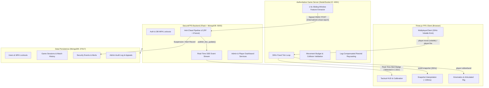

# SecureFPS: Platform Architecture & Technical Design

## 1. High-Level System Architecture

SecureFPS combines an authoritative multiplayer game server, an intelligent AI/ML anti-cheat pipeline, a Flask security backend, and a modern Three.js client engine into a unified competitive FPS ecosystem:

---

## 2. Component Responsibilities

### 2.1 Three.js Gameplay Engine (`frontend/public/games/three-fps/`)
- **Rendering & Locomotion:** Proportional anatomical tactical rig with FAST high-cut helmet, plate carrier, ballistic goggles, and multi-weapon support (Carbine, SMG, Sniper, Pistol).
- **Client Prediction & Netcode:** Cosmetic local prediction (muzzle flash, audio, tracer) paired with strict server arbitration. Receives timestamped server snapshots and performs shortest-arc yaw slerp with frame-rate independent exponential smoothing ($1 - e^{-22 \Delta t}$).
- **Diagnostic Overlays:** F3 developer diagnostics panel providing live socket calibration sliders and real-time RTT, jitter, and packet loss monitoring.

### 2.2 Authoritative Game Server (`multiplayer-server/server.js`)
- **30Hz Server Tick Loop:** Simulates physics, kinematic bounds, and spatial displacements every 33.33ms.
- **Server-Side Hitscan & Lag Compensation:** Maintains a 1.2s rolling position history ring buffer. Rewinds target positions to the exact firing timestamp, calculates raycast headshot intersections, and validates line-of-sight occlusion against arena bounding boxes.
- **Sliding-Window Telemetry Extraction:** Computes multi-dimensional behavioral features every 1.5 seconds and streams HMAC-signed payloads to the Flask ML pipeline.

### 2.3 Flask Anti-Cheat & Security Backend (`backend/`)
- **Dual Ensemble ML Pipeline:** Combines a calibrated Random Forest classifier ($0.60$ weight) with an Isolation Forest anomaly detector ($0.40$ weight).
- **Defensive API Hardening:** DB-backed MFA attempt tracking with automated 15-minute lockouts after 5 consecutive failures, ProxyFix trusted header extraction, generic password reset responses, and HTML escaping across all email templates.
- **Real-Time SSE Distribution:** In-memory subscriber queue system delivering sub-millisecond live alerts with `Last-Event-ID` missed event replay.
